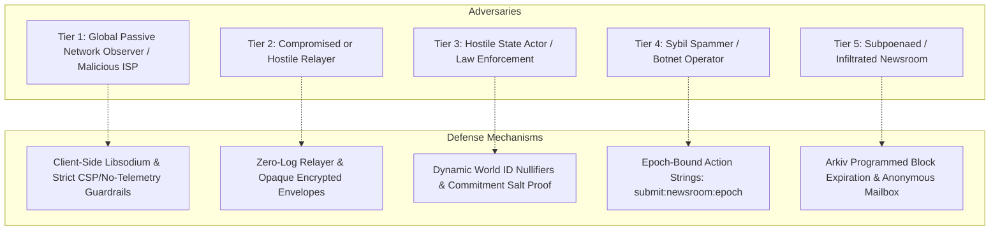

# Blind Report — Threat Model & Cryptographic Security Architecture

> **Security & Privacy Specification for Whistleblower Protection**  
> **Target Audience:** Security Auditors, ETHGlobal Judges, Investigative Journalists, Civil Rights Organizations.

---

## 1. Executive Summary

Traditional anonymous submission systems (such as legacy whistleblowing portals or web forms) suffer from three critical architectural vulnerabilities:
1. **Centralized Trust & PKI Fragility:** Sources rely on TLS certificates issued by centralized Certificate Authorities (CAs) and DNS records prone to BGP hijacking, state-level spoofing, or administrative seizure.
2. **Denial-of-Service & Sybil Flooding:** Without source authentication, newsrooms are overwhelmed by automated spam, corrupting triage and depleting journalistic resources. If authentication is introduced, it typically compromises source anonymity.
3. **Data Lifecycle & Surveillance Sprawl:** Centralized databases and permanent IPFS pins create perpetual digital footprints vulnerable to retrospective correlation, warrant subpoenas, or indefinite data retention violations (e.g., GDPR right-to-be-forgotten).

**Blind Report** solves these challenges by combining three decentralized protocols:
- **ENSv2 (Ethereum Name Service)** as a decentralized Public Key Infrastructure (PKI) and delegable subname authority directory.
- **World ID (Worldcoin Protocol 4.0)** for zero-knowledge proof (ZKP) Proof of Humanity and rate-limiting anti-Sybil protection without civil identity exposure.
- **Arkiv Network** for immutable, block-expiring decentralized storage with verifiable third-party gas sponsorship and custody transfer.
- **Libsodium Cryptography (X25519 & ChaCha20-Poly1305)** for authenticated, hybrid end-to-end envelope encryption.

---

## 2. Adversary Model & Assumptions

We evaluate system resilience against five distinct adversary tiers:

### Tier 1: Global Passive Network Observer (ISP / Wiretap)
- **Capability:** Intercepts, records, and analyzes all HTTP traffic traversing regional network links.
- **Mitigation:**
  - Zero third-party telemetry, trackers, or external CDN calls (`RNF-05` guardrails enforced at build time).
  - All sensitive data (plaintext, metadata, file attachments) is sealed in an authenticated Libsodium envelope inside the browser sandbox before network dispatch.
  - The payload traversing the network to the Relayer is indistinguishable from random bytes.

### Tier 2: Hostile / Compromised Relayer
- **Capability:** The Relayer operator inspects incoming payloads, attempts to correlate submissions with IP addresses, or selectively drops/censors submissions.
- **Mitigation:**
  - **Payload Confidentiality:** The Relayer never receives decryption keys; it cannot inspect the confidential report or attachments.
  - **Zero IP Persistence:** The Relayer implementation strictly excludes client IP logging from application memory and disk logs.
  - **Censorship Resilience:** Relayer endpoints are advertised transparently in the newsroom's ENS text records (`blindreport.relayers`). Sources may choose any secondary relayer or broadcast directly to an Arkiv node if funded.

### Tier 3: Hostile State Actor / Cross-Context Correlation
- **Capability:** Possesses vast computing resources; seeks to correlate whether the same physical person submitted reports to different newsrooms or across different months.
- **Mitigation:**
  - **Action-Bound Nullifiers:** World ID ZKP proofs derive nullifiers scoped strictly to a dynamic action:
    $$\text{action} = \text{"submit:"} + \text{newsroomName} + \text{":"} + \text{epoch}$$
  - A person's nullifier for `jornal-livre.eth` in November 2026 is mathematically unlinkable to their nullifier for `guardian.eth`, or to their nullifier in December 2026. Zero cross-context profiling is possible.

### Tier 4: Sybil Spammer / Disinformation Botnet
- **Capability:** Attempts to submit millions of garbage reports to paralyze newsroom editorial workflows.
- **Mitigation:**
  - The Relayer and newsroom gate enforce valid World ID Protocol 4.0 ZKP proofs.
  - Each human can only generate **one valid nullifier per newsroom per epoch** (monthly by default).
  - Any subsequent submission in the same epoch by the same individual triggers a deterministic `409 Conflict (SYBIL_ATTACK_DETECTED)` without exposing the source's identity.

### Tier 5: Subpoenaed Newsroom & Retroactive Doxxing
- **Capability:** An adversary seizes newsroom servers months later and demands to know the identity of the source who leaked a sensitive document.
- **Mitigation:**
  - **Arkiv Block Expiration:** Envelopes have a deterministic retention period (e.g., 90 days). Once expired without explicit editorial extension, the entity is pruned by Arkiv nodes.
  - **No Stored Source Identifiers:** The newsroom inbox only stores the encrypted envelope, content hash, and ephemeral reply mailbox public key.
  - **Voluntary Authorship Proof (Commitment Salt):** If the source later wishes to prove in court or to another media outlet that they originated the leak, they reveal their private cryptographic salt:
    $$\text{Commitment} = \text{BLAKE2b}(\text{Content} \parallel \text{Salt})$$
    Anyone can verify the math against the Arkiv entity hash without having known the source's identity prior to the revelation.

---

## 3. Cryptographic Primitives & Specifications

| Function | Primitive | Standard / Library | Purpose |
| :--- | :--- | :--- | :--- |
| **Asymmetric Key Exchange** | X25519 (Curve25519) | Libsodium `crypto_box` | Key encapsulation between source and newsroom public keys |
| **Symmetric Payload Ciphers** | ChaCha20-Poly1305 | RFC 8439 / Libsodium | Authenticated encryption with associated data (AEAD) for envelopes |
| **Content Integrity & Hashing** | BLAKE2b / SHA-256 | Libsodium / Viem | Deterministic content identification and envelope verification |
| **Zero-Knowledge Proofs (ZKP)** | Groth16 / Semaphore | World ID Protocol 4.0 | Proof of Humanity and nullifier derivation without biometric disclosure |
| **Anonymous Return Channel** | Ephemeral X25519 Mailbox | Libsodium | Sealed replies addressed to source's ephemeral key stored in Arkiv |
| **Decentralized PKI** | ENSv2 Text Records & NameWrapper | EIP-137 / EIP-3668 | Cryptographic public key resolution and subname delegated authority |

---

## 4. Network Policy & Guardrail Verification (RNF-05)

The Blind Report codebase is guarded by automated static analysis (`npm run guardrails` and `npm run test:guardrails`):
- **Zero Third-Party Leaks:** Hardcoded HTTP endpoints outside approved node RPCs are flagged and blocked during build time.
- **Content Security Policy (CSP):** Delivered with strict `connect-src` allowlists matching only the designated Ethereum RPC, Arkiv RPC, and Relayer endpoint.
- **Static Artifact Delivery:** Frontends are distributed as deterministic static bundles with zero server-side rendering vulnerabilities.
